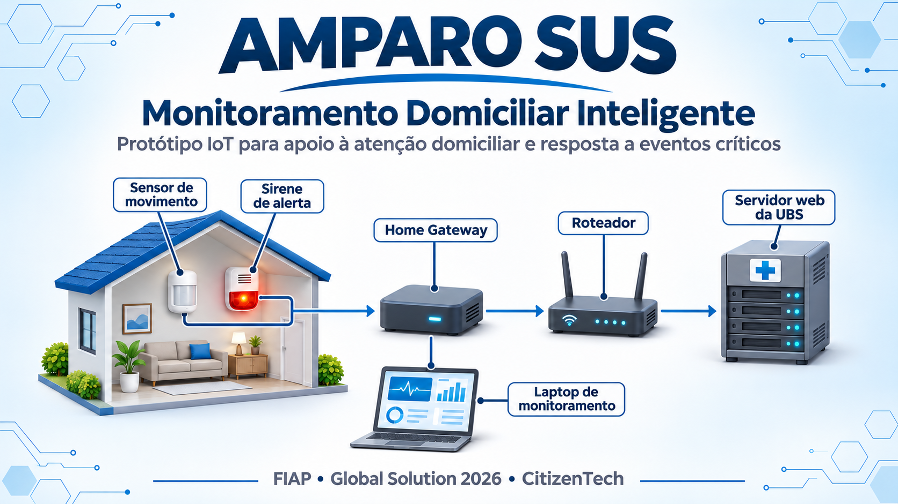
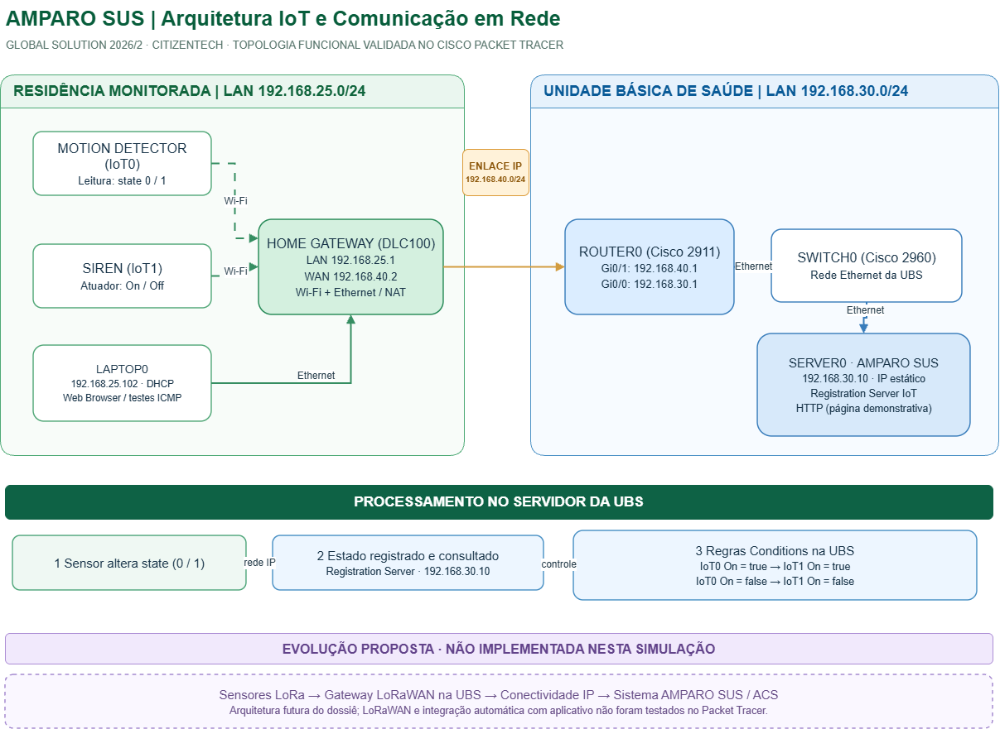
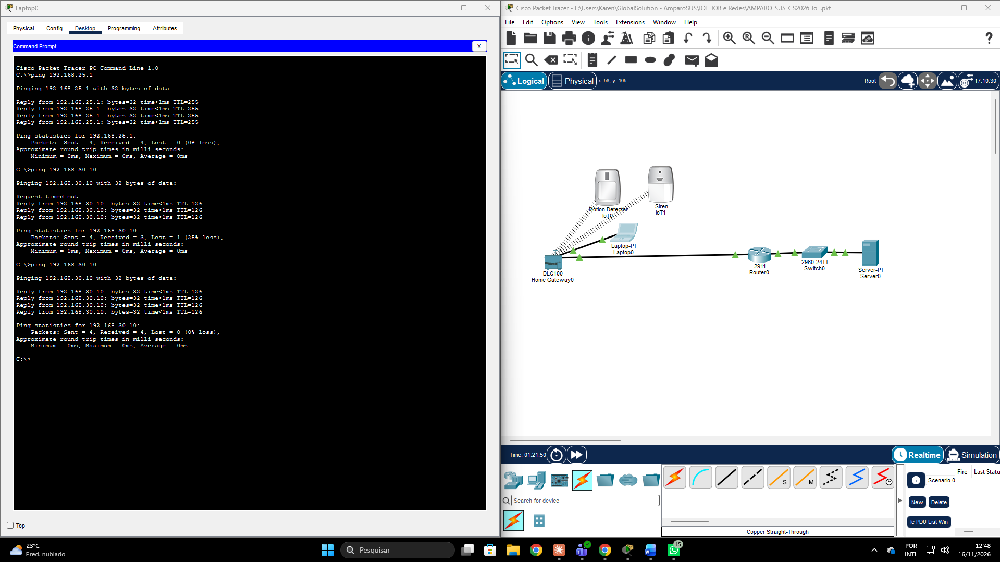
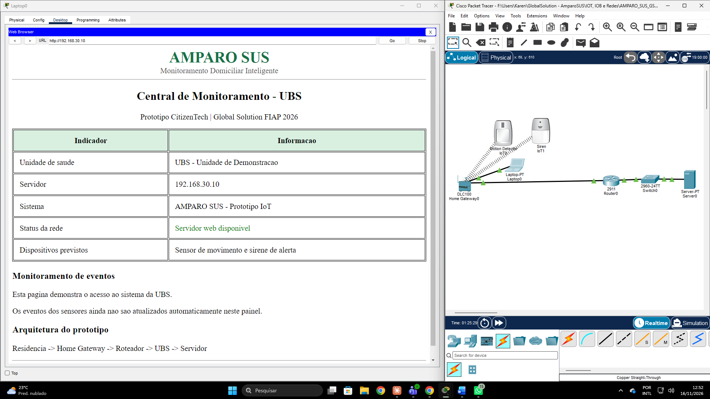
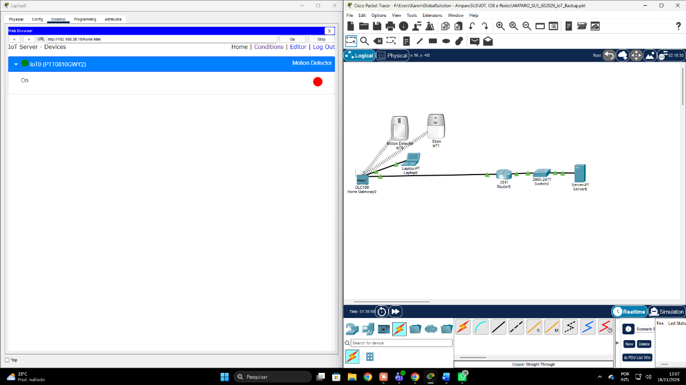
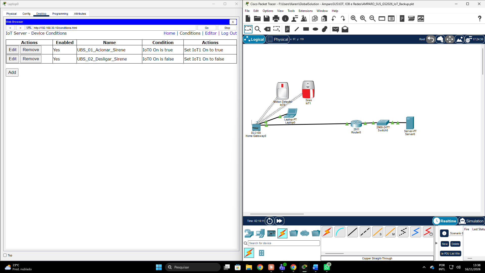
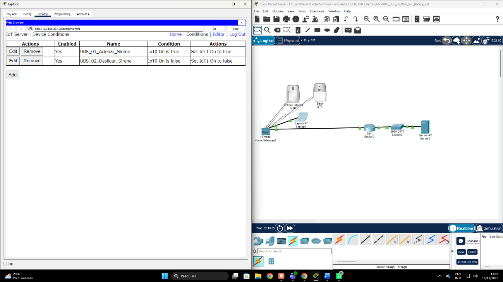

# AMPARO SUS — Protótipo IoT e Comunicação em Rede

<p align="center">
  
</p>

**Global Solution 2026/2 • CitizenTech • FIAP**  
**Disciplina:** Disruptive Architectures: IoT, IoB & Generative IA  
**Repositório:** https://github.com/karenlldl/amparo-sus-iot

> **Status:** prova de conceito funcional no Cisco Packet Tracer. A simulação demonstra comunicação IP, cadastro remoto de dispositivos IoT e automação condicional. Não é um dispositivo médico e não representa uma implantação real em uma UBS.

## 1. Problema social e proposta CitizenTech

O **AMPARO SUS** propõe apoiar o acompanhamento domiciliar de **idosos com doenças crônicas em situação de vulnerabilidade**, especialmente quando há dificuldade de acesso à internet residencial e de contato frequente com a equipe de saúde. Entre uma visita e outra do **Agente Comunitário de Saúde (ACS)**, a UBS pode ter pouca visibilidade sobre mudanças na rotina do paciente. Isso limita a capacidade de reconhecer situações que mereçam uma avaliação presencial, sem que o projeto pretenda substituir o cuidado humano ou o diagnóstico clínico.

A proposta do ecossistema completo é utilizar sensores domésticos discretos e comunicação de baixo consumo para encaminhar **eventos de interesse** à UBS, onde profissionais poderiam organizar o acompanhamento e priorizar verificações. **Na prova de conceito desta disciplina**, o recorte é mais específico: demonstrar, no Cisco Packet Tracer, que a mudança de estado de um **sensor de movimento residencial** pode ser consultada por um **servidor IoT remoto da UBS** e resultar no acionamento/desligamento de uma **sirene simulada** conforme regras condicionais.

O protótipo valida **conectividade, registro remoto e automação**, não a identificação de emergências médicas. Um evento de movimento isolado não representa risco clínico. A utilidade para o cidadão está no **potencial de criar uma infraestrutura de acompanhamento mais acessível**, sujeita a validações técnicas, clínicas e de privacidade antes de qualquer uso real.

### Objetivos demonstrados

- Simular o **Motion Detector (`IoT0`)** e a **Siren (`IoT1`)**, observando mudança de estado e resposta de um atuador.
- Interligar **residência e UBS** por três redes IPv4 e demonstrar conectividade com testes ICMP.
- Registrar dispositivos no **Registration Server IoT da UBS** e consultar alterações de estado pela interface web.
- Executar duas regras no servidor remoto: **ativar a sirene quando o sensor é acionado** e **desativá-la quando o sensor retorna ao estado inativo**.
- Documentar a reprodução do protótipo, a arquitetura, os resultados dos testes e suas limitações.

**Público beneficiado na proposta:** idosos crônicos de baixa renda, famílias, ACS e equipes da atenção primária. **ODS relacionados:** ODS 3 (Saúde e Bem-Estar), ODS 9 (Indústria, Inovação e Infraestrutura) e ODS 10 (Redução das Desigualdades). Esses vínculos expressam a **finalidade social da proposta**, não impactos já mensurados.

## 2. Equipe

| Integrante | RM | Turma |
|---|---|---|
| Denise Aparecida Santos da Silva | 567559 | 2TDSPA |
| Pedro Begali Campos | 567478 | 2TDSPA |
| Lucas de Souza Dudena | 567600 | 2TDSPA |
| Karen Lucinda Lira Cardoso | 566870 | 2TDSPA |

## 3. Arquitetura de rede



**Arquivos da arquitetura:** [Imagem PNG](AMPARO_SUS_Arquitetura_IoT.png) · [Diagrama editável DRAWIO](AMPARO_SUS_Arquitetura_IoT.drawio)

### Componentes implementados

| Ambiente | Componente | Modelo no Packet Tracer | Função |
|---|---|---|---|
| Residência | Sensor de movimento | Motion Detector / `IoT0` | Alternância entre estados inativo e ativo |
| Residência | Sirene | Siren / `IoT1` | Atuador acionado pelas regras IoT |
| Residência | Gateway | Home Gateway / DLC100 | Conexões Wi-Fi e Ethernet, rede doméstica e interface externa |
| Residência | Estação de teste | Laptop-PT / `Laptop0` | Configuração, navegador e testes de rede |
| UBS | Roteador | Cisco 2911 / `Router0` | Interligação entre redes IPv4 |
| UBS | Switch | Cisco 2960-24TT / `Switch0` | Comutação Ethernet local |
| UBS | Servidor | Server-PT / `Server0` | Servidor IoT de registro, regras e serviço HTTP |

### Endereçamento IPv4 da simulação

| Rede / interface | Endereço | Máscara / observação |
|---|---|---|
| LAN residencial | `192.168.25.0/24` | Máscara `255.255.255.0` |
| Home Gateway — LAN | `192.168.25.1` | Gateway da residência |
| Laptop0 | `192.168.25.102` | Endereço obtido por DHCP durante os testes |
| Motion Detector | `192.168.25.110` | IP estático configurado posteriormente |
| Home Gateway — Internet | `192.168.40.2` | Interligação |
| Router0 — GigabitEthernet0/1 | `192.168.40.1` | Interligação `192.168.40.0/24` |
| Router0 — GigabitEthernet0/0 | `192.168.30.1` | Gateway da UBS |
| Server0 | `192.168.30.10` | IP estático / rede `192.168.30.0/24` |

As configurações dos demais dispositivos podem ser verificadas diretamente no arquivo `.pkt`. O endereço do Laptop0 é o observado na evidência de DHCP e pode variar se a concessão for renovada. O IP fixo do Motion Detector foi configurado posteriormente para recuperar a conectividade durante os testes.

### Meios de comunicação e fluxo dos dados

O projeto distingue **aquisição do evento, transporte de dados, processamento da regra e atuação de retorno**:

1. **Aquisição:** o Motion Detector (`IoT0`) muda seu atributo lógico de estado durante a simulação, acionado manualmente para reproduzir um evento residencial.
2. **Rede residencial:** o dispositivo usa o enlace **Wi-Fi** com o Home Gateway (`192.168.25.1`); o Laptop0 usa **Ethernet** para acesso e diagnóstico.
3. **Interligação:** a interface Internet do Home Gateway (`192.168.40.2`) se comunica com o Router0 (`192.168.40.1`) pela rede `192.168.40.0/24`.
4. **Rede da UBS:** o Router0 encaminha a comunicação pela interface `192.168.30.1`, passando pelo **Switch0**, até o **Server0 (`192.168.30.10`)**.
5. **Registro e decisão:** o **Registration Server IoT** da UBS apresenta os estados dos dispositivos e executa as regras configuradas em **Conditions**.
6. **Ação de retorno:** conforme a condição, a regra envia o comando de **ligar ou desligar a Siren (`IoT1`)**, que também está na residência, mas registrada no servidor IoT remoto.

**Dois fluxos são demonstrados:** **residência → UBS** (estado do sensor) e **UBS → residência** (controle do atuador). Não afirmamos que esse fluxo usa MQTT ou LoRaWAN, pois esses protocolos **não foram implementados ou comprovados nesta simulação**.

| Tecnologia / recurso | Papel na simulação | Evidência de verificação |
|---|---|---|
| Wi-Fi | Conectar sensor e sirene ao Home Gateway | Topologia, cadastro de dispositivos |
| Ethernet | Interligar equipamentos cabeados | Enlaces e topologia |
| IPv4 + DHCP / IP estático | Identificar e alcançar dispositivos e redes | Configuração IP e testes `ping` |
| ICMP | Confirmar alcançabilidade | Respostas e perdas de pacotes |
| HTTP | Acessar serviços web no Server0 | Página AMPARO SUS e interface de registro |
| Registration Server IoT / Conditions | Consultar estados e executar regras | Cadastro remoto e automação da sirene |

**Limite do painel demonstrativo:** a página HTML personalizada mostrada na **Evidência 11** comprovou **acesso HTTP entre redes**, mas é **estática**; ela não recebe automaticamente os eventos do sensor. A visualização de estados e as regras funcionais foram testadas na interface **nativa do Registration Server IoT**.

## 4. Regras de automação

Na configuração final testada, **Motion Detector e Siren** estão cadastrados no **Registration Server IoT da UBS** (`192.168.30.10`). As regras ativas devem ser verificadas em **Conditions** desse servidor.

| Regra | Condição (IF) | Ação (THEN) | Resultado esperado |
|---|---|---|---|
| `UBS_01_Acionar_Sirene` | `IoT0 → On → is true` | `IoT1 → On → true` | Ativar a sirene |
| `UBS_02_Desligar_Sirene` | `IoT0 → On → is false` | `IoT1 → On → false` | Desativar a sirene |

As primeiras automações foram implementadas no Home Gateway para validar o conceito localmente; posteriormente, foram configuradas no servidor remoto da UBS. A simulação de **movimento → sirene** representa um **teste técnico de comunicação e controle**, não um protocolo clínico válido de alerta ou diagnóstico.

## 5. Decisões e justificativas técnicas

| Escolha | Por que foi utilizada | Limite da escolha |
|---|---|---|
| **Cisco Packet Tracer** | Reproduzir o cenário residencial e a rede da UBS, configurar dispositivos e testar comunicação em um único ambiente acessível | É um simulador; não mede desempenho de hardware ou rede real |
| **Motion Detector** | Gerar um evento binário (`state 0/1`) simples, verificável e adequado para demonstrar a entrada de dados IoT | Um evento de movimento isolado não detecta queda, doença nem ausência anormal de atividade |
| **Siren** | Tornar visível o resultado de uma regra automática de atuação | Recurso didático; não representa o alerta clínico final nem protocolo de resposta a emergências |
| **Home Gateway e Wi-Fi** | Concentrar os dispositivos domésticos e oferecer uma saída de rede para a UBS | A disponibilidade depende do gateway e da conectividade configurada |
| **Router 2911 e Switch 2960** | Separar a rede residencial da rede da UBS, reproduzindo roteamento e comutação | Não representam uma infraestrutura de telecomunicações pública ou implantada |
| **Server0 com Registration Server IoT** | Centralizar o cadastro, a consulta de estados e as regras acionadas na UBS | Interface de simulação, sem integração real com sistemas SUS |
| **IPv4, DHCP e IP estático** | Usar DHCP na estação de teste e endereços conhecidos para infraestrutura e servidor, facilitando a reprodução e o diagnóstico | A escolha não equivale a uma política completa de segurança ou gestão de rede |
| **ICMP e HTTP** | Comprovar comunicação básica entre redes e acesso à interface web | Não comprovam sozinhos a entrega contínua de eventos, criptografia ou confiabilidade em produção |

**Por que centralizar as regras na UBS?** A primeira automação foi validada localmente no Home Gateway. Ao migrar o cadastro do sensor para o servidor remoto, as regras locais deixaram de acioná-lo; por isso, a configuração final registra **sensor e sirene no mesmo Registration Server da UBS** e mantém ali as duas condições. A mudança permite demonstrar monitoramento e atuação a partir da unidade de saúde, com os dispositivos ainda localizados na residência.

**Arduino:** não integra este protótipo. O grupo utilizou a **simulação no Cisco Packet Tracer**, alternativa confirmada pelo professor da disciplina, que informou não ter ministrado Arduino como requisito prático obrigatório. Essa decisão é explicitada para não apresentar indevidamente firmware, circuitos ou sensores físicos como entregues.

**LoRaWAN:** faz parte da **arquitetura futura proposta** para cenários com limitações de conectividade e necessidade de baixo consumo, mas **não foi configurado nem testado no Packet Tracer**. A simulação entregue utiliza **Wi-Fi, Ethernet e redes IPv4**, conforme o diagrama.

## 6. Como executar e reproduzir

### Pré-requisitos

- Cisco Packet Tracer com suporte aos dispositivos IoT e ao modelo de Home Gateway utilizado no projeto.
- Arquivo de simulação deste repositório.
- Navegador embutido e os componentes de rede habilitados na simulação.

### Abrir o projeto

1. Baixe [`AMPARO_SUS_GS2026_IoT.pkt`](AMPARO_SUS_GS2026_IoT.pkt).
2. Abra-o no **Cisco Packet Tracer** por meio de **File → Open**.
3. Selecione **Logical** e aguarde a inicialização dos dispositivos.
4. Confira os enlaces verdes da rede e, caso necessário, aguarde sua estabilização.
5. Abra o **Laptop0 → Desktop → IP Configuration** e confira sua configuração de rede.

### Teste A — Conectividade residencial

Abra **Laptop0 → Desktop → Command Prompt** e execute:

```text
ping 192.168.25.1
```

**Critério:** receber respostas do gateway residencial.

### Teste B — Conectividade residência–UBS

No mesmo prompt, execute:

```text
ping 192.168.30.10
```

**Critério:** obter respostas do servidor da UBS. Na execução documentada, o primeiro teste recebeu 3/4 pacotes e a repetição recebeu 4/4.

### Teste C — Acesso ao servidor HTTP

1. Em **Laptop0 → Desktop → Web Browser**, acesse `http://192.168.30.10`.
2. No estado final do protótipo, o serviço **Registration Server IoT** está ativado e pode exibir a tela de autenticação no lugar da página HTML de demonstração.
3. Entre com as credenciais **de laboratório** definidas no ambiente do Packet Tracer. Não utilize senhas pessoais; se criar outras credenciais para a sua cópia, configure as mesmas nos dispositivos registrados.
4. Confira se **IoT0** e **IoT1** aparecem no painel **Devices**.

> Para reproduzir o teste HTTP da página personalizada, consulte a Evidência 11. A habilitação do Registration Server altera o conteúdo apresentado na rota principal; portanto, não espere visualizar simultaneamente a página HTML estática e o painel de registro na mesma URL.

### Teste D — Monitoramento remoto e automação

1. No Server0, confira em **Services → IoT** que o **Registration Server** está **On**.
2. No painel da UBS, verifique o cadastro de **IoT0** e **IoT1**.
3. Abra **Conditions** e confirme as duas regras da seção 4, ambas habilitadas.
4. Na topologia, altere o estado do Motion Detector usando **Alt + clique**.
5. Observe a alteração do estado no painel do servidor IoT e o acionamento da sirene.
6. Desative o sensor com **Alt + clique** e verifique o desligamento automático da sirene.
7. Se o navegador mostrar informações antigas, use **Go** para atualizar a página.

**Nota de reprodução:** a implementação final usa cadastro remoto dos dois dispositivos. Se um deles não aparecer, conferir `Config → Settings → Remote Server`, endereçamento IPv4, gateway e conectividade. Não substituir a configuração final pelas regras do Home Gateway sem registrar a mudança de cenário.

## 7. Testes e evidências

Os resultados abaixo refletem os testes documentados durante o desenvolvimento, no Cisco Packet Tracer. Eles não constituem métricas de disponibilidade de uma rede de produção.

| Caso | Cenário | Critério / resultado observado | Evidência |
|---|---|---|---|
| T01 | Topologia residencial inicial | Enlaces ativos | [01](evidencias/EVID_01_Topologia_Inicial.png) |
| T02 | Configuração de DHCP no Laptop0 | IP `192.168.25.102`, máscara `/24`, gateway `192.168.25.1` | [02](evidencias/EVID_02_Configuracao_DHCP.png) |
| T03 | ICMP Laptop0 → Home Gateway | 4 enviados / 4 recebidos (0% de perda) | [03](evidencias/EVID_03_Teste_Conectividade_ICMP.png) |
| T04 | Registro IoT no Home Gateway | Motion Detector listado | [04](evidencias/EVID_04_Sensor_Registrado_Gateway.png) |
| T05 | Mudança de estado do sensor | `state = 0` e `state = 1` | [05A](evidencias/EVID_05A_Sensor_Movimento_Estado_0.png) / [05B](evidencias/EVID_05B_Sensor_Movimento_Estado_1.png) |
| T06 | Registro de dois dispositivos | Motion Detector e Siren listados | [06](evidencias/EVID_06_Integracao_Dispositivos_IoT.png) |
| T07 | Automação local — acionamento | Sirene ativada por condição | [07](evidencias/EVID_07_Automacao_IoT_Funcional.png) |
| T08 | Automação local — desligamento | Sirene desativada por condição | [08](evidencias/EVID_08_Desligamento_Automatico_Sirene.png) |
| T09 | ICMP Server0 → Router0 | 4 enviados / 4 recebidos (0% de perda) | [09A](evidencias/EVID_09A_Configuracao_Roteador_UBS.png) / [09B](evidencias/EVID_09B_Conectividade_Rede_UBS.png) |
| T10 | ICMP Laptop0 → Server0 | 3/4 na primeira execução; 4/4 na segunda | [10A](evidencias/EVID_10A_Configuracao_Interligacao.png) / [10B](evidencias/EVID_10B_Comunicacao_Residencia_UBS.png) |
| T11 | Página HTTP da UBS | Acesso à página personalizada via rede residencial | [11](evidencias/EVID_11_Acesso_HTTP_Sistema_UBS.png) |
| T12 | Registro remoto do sensor | IoT0 listado no servidor IoT da UBS | [12](evidencias/EVID_12_Registro_Remoto_Sensor_UBS.png) |
| T13 | Estados no painel remoto | Alternância visual observada (ver nota) | [13A](evidencias/EVID_13A_Painel_Remoto_Indicador_Vermelho.png) / [13B](evidencias/EVID_13B_Painel_Remoto_Indicador_Verde.png) |
| T14 | Automação no servidor remoto da UBS | Sirene acionada e desligada segundo as regras | [14A](evidencias/EVID_14A_Automacao_Remota_Sirene_Ativa.png) / [14B](evidencias/EVID_14B_Automacao_Remota_Sirene_Inativa.png) |

**Observação sobre a Evidência 13:** as legendas de *ativo/inativo* no Word original não estão consistentes com as cores em todas as capturas. Por isso, os arquivos extraídos usam nomes **vermelho/verde**, que descrevem apenas o indicador observado. Para concluir sobre o estado lógico do sensor, confirme também `Attributes → state` na simulação. **Não se deve deduzir exclusivamente a detecção de movimento pela cor.**

### Galeria das principais evidências

<details>
<summary><strong>Comunicação IP — T10</strong></summary>



</details>

<details>
<summary><strong>Acesso HTTP à UBS — T11</strong></summary>



</details>

<details>
<summary><strong>Registro remoto de dispositivo — T12</strong></summary>


</details>

<details>
<summary><strong>Comparação do painel remoto — T13</strong></summary>




</details>

<details>
<summary><strong>Automação remota — T14</strong></summary>





</details>

## 8. Limitações e próximos passos

- O projeto é uma **simulação**; não possui sensores físicos, circuito eletrônico construído ou firmware embarcado.
- As conexões IoT sem fio foram modeladas com os recursos do Packet Tracer; **LoRa/LoRaWAN não foi implementado nem medido**.
- A alteração de estado do Motion Detector é simulada manualmente; não comprova sensibilidade ou precisão de detecção física.
- A sirene é um atuador demonstrativo; acioná-la por movimento não constitui um protocolo adequado para identificar emergências reais.
- O serviço nativo de Registration Server permite gerenciamento IoT; a página HTML personalizada é **estática** e não integra automaticamente os eventos.
- Não foram implementados modelos de IA, classificação preditiva, prontuário, integração ao SUS ou aplicativo funcional para ACS neste repositório IoT.
- O teste de conectividade não mede capacidade, latência real, cobertura, segurança ou disponibilidade de uma implantação.
- A autenticação e os dados usados são **exclusivamente demonstrativos**. Uma implantação real exigiria proteção de credenciais, controles de acesso, LGPD, validação clínica e políticas de segurança.

**Evolução proposta, não desenvolvida nesta simulação:** sensores adequados ao contexto domiciliar, gateway LoRaWAN na UBS, identificação de anomalias com validação técnica e clínica, notificação aos ACS, banco de dados e observabilidade.

## 9. Estrutura dos arquivos

```text
amparo-sus-iot/
├── README.md
├── AMPARO_SUS_GS2026_IoT.pkt
├── AMPARO_SUS_Arquitetura_IoT.drawio
├── AMPARO_SUS_Arquitetura_IoT.png
└── evidencias/
    ├── EVID_01_Topologia_Inicial.png
    ├── ...
    ├── EVID_13A_Painel_Remoto_Indicador_Vermelho.png
    ├── EVID_13B_Painel_Remoto_Indicador_Verde.png
    ├── EVID_14A_Automacao_Remota_Sirene_Ativa.png
    └── EVID_14B_Automacao_Remota_Sirene_Inativa.png
```

> Os links acima pressupõem que os arquivos `.pkt` e de arquitetura estão na **raiz**, e que as imagens estão dentro de `evidencias/`. Caso o GitHub tenha colocado arquivos em outra pasta, os caminhos devem ser ajustados.

## 10. Entrega acadêmica e declaração de uso de IA

**Disciplina:** Disruptive Architectures: IoT, IoB & Generative IA — FIAP  
**Desafio:** Global Solution 2026/2 — CitizenTech

De acordo com a rubrica da disciplina, o **Portal FIAP** recebe um arquivo de texto (`.txt`) contendo **nome completo, RM dos integrantes e o link deste repositório público**. Os materiais técnicos e evidências ficam disponíveis neste GitHub. Confirmar também as orientações gerais de identificação e o prazo da turma antes do envio.

**Uso de IA generativa (declaração a validar pelo grupo):** ferramentas de IA foram utilizadas como apoio à organização da documentação, estruturação de textos e orientação técnica durante a elaboração da simulação. As configurações e os testes devem ser conferidos e compreendidos pelos integrantes; a execução prática e a validação final permanecem responsabilidade do grupo.

---

**AMPARO SUS — Tecnologia a serviço do cuidado e da atenção primária.**
